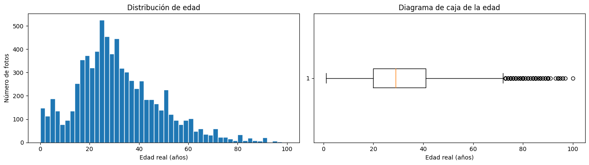

# Age estimation with transfer learning

Academic computer vision project completed during TripleTen's Data Science program. The task was to estimate age from labeled face photographs using a pretrained neural network.

**Historical result:** ResNet50 reached a final **validation MAE of 5.90 years** after 20 epochs. The best observed validation MAE was 5.76 years at epoch 15. These are validation results, not independent test results or evidence of reliable age verification.

## Approach

- Explored 7,591 labeled images, age imbalance and variation in image size.
- Loaded images in batches, resizing to 224 × 224 pixels and rescaling by 1/255.
- Used horizontal flips for training augmentation.
- Fine-tuned ImageNet-pretrained ResNet50 with global average pooling and a single ReLU output.
- Optimized mean squared error with Adam at learning rate 0.0001 and monitored mean absolute error.

## Historical training run

| Item | Recorded value |
|---|---|
| Training images | 5,694 |
| Validation images | 1,897 |
| Epochs | 20 |
| Final training MAE | 2.2464 years |
| Final validation MAE | 5.9011 years |
| Best observed validation MAE | 5.7592 years, epoch 15 |
| Framework | TensorFlow 2.15.1 |
| Hardware | NVIDIA RTX 3060 Ti, 8 GB |



The training output is preserved in [training_output.txt](training_output.txt). The notebook contains the EDA and training functions; the GPU run was performed separately and its log inserted into the original submission. Opening or executing the notebook alone does not retrain the network.

## Interpretation and limitations

The train/validation gap indicates overfitting. Age imbalance and potentially approximate labels also limit interpretation. The original split is an image-level split; it was not verified as identity-disjoint, and no independent external test set was used. Error near age 18 and across demographic groups was not established.

The aggregate MAE does not demonstrate that the model can verify legal age, reliably segment every age group or run in real time. No retail deployment or business benefit was measured. Face photographs, labels and model weights are excluded from this repository.

Potential next experiments include identity-disjoint evaluation, per-age-group errors, early stopping, checkpoint selection and comparison against the preprocessing expected by the pretrained ResNet50 weights. They are proposed work, not completed improvements.

## Files and usage

- [Executed EDA and model notebook](age_estimation.ipynb), in Spanish with an English portfolio note.
- [Training script](train.py), adapted from the original local GPU script.
- [Data layout](DATA.md) and [preparation review](REVIEW.md).

For local exploration, use Python 3.10 or 3.11 from this repository directory:

```bash
python -m venv .venv
source .venv/bin/activate
python -m pip install -r requirements.txt
jupyter notebook age_estimation.ipynb
```

To train separately after obtaining the dataset and configuring a compatible TensorFlow environment:

```bash
python train.py data/faces/
```

The path argument must end in `/`. Training writes `goodseed_resnet50.h5`, which is ignored by Git. It downloads ImageNet weights and benefits from a GPU. Hardware, nondeterministic GPU operations and dependency versions can change the result; this preparation did not repeat the original run or verify a fresh environment.

## Attribution

Assignment context, dataset access and the notebook scaffold were supplied by TripleTen. Dataset redistribution rights are not assumed. This portfolio edition omits photo montages and replaces unsupported deployment claims in the original conclusion with the limitations above. The original local submission remains unchanged.
